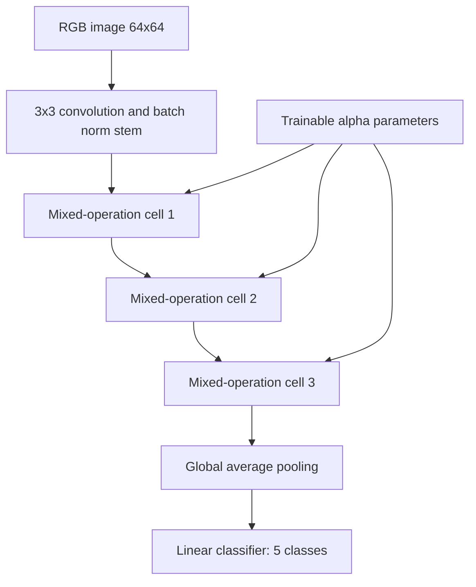

# Methods and experimental protocol (code-derived)

## DARTS-style network
`src/nas_darts_model.py` implements a convolution/batch-norm stem, three cells, softmax-normalized per-cell architecture parameters (`alphas`), global average pooling and a five-way linear classifier. Each cell computes a weighted sum of candidate operations from `src/nas_darts_search_space.py` / `src/nas_operations.py`. The training code optimizes all parameters jointly with Adam, rather than a conventional DARTS bilevel train/validation optimization. `parse_genotype` selects the maximum-weight operation per cell and writes a text artifact; no separate discretized network is retrained.

## ResNet50
`src/model_utils.py` creates torchvision ResNet50 with pretrained weights by default and replaces the final classifier with a five-output linear layer. `src/data_utils.py` uses 224×224 resized images and ImageNet normalization. The code defines random flip/rotation augmentation, but a shared underlying `ImageFolder` object means assigning validation transforms also changes training transforms.

## Evaluation validity
- DARTS training uses an unseeded 80/20 random split; `src/evaluate_darts.py` creates a **new** random 80/20 split, potentially reusing training samples.
- `src/nas_evaluate.py` evaluates the entire dataset rather than a held-out test set.
- ResNet evaluation runs on a validation split, not an independently preserved test set; augmentation assignment is flawed.
- The baseline comparison is confounded by pretrained vs nonpretrained initialization, 224 vs 64 input resolution, different optimization settings and unknown split correspondence.
- No group/patient-disjoint split, confidence interval, repeated-seed variance or external validation is demonstrated.

**Do not infer clinical performance or architecture-search superiority from the saved outputs.**
