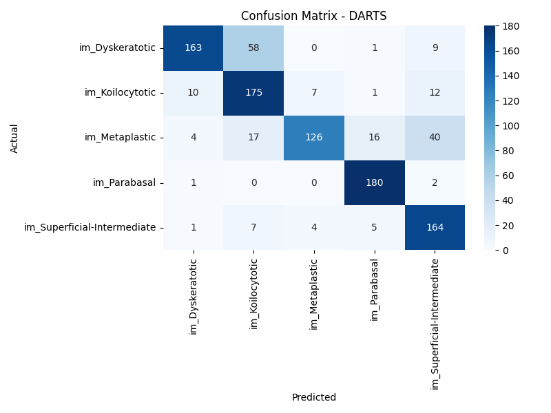
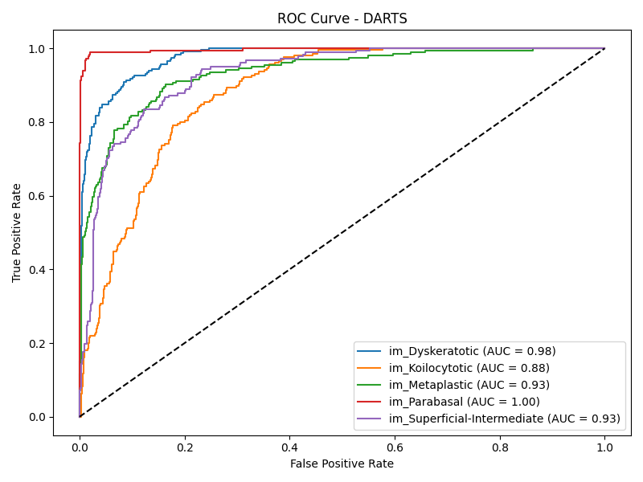
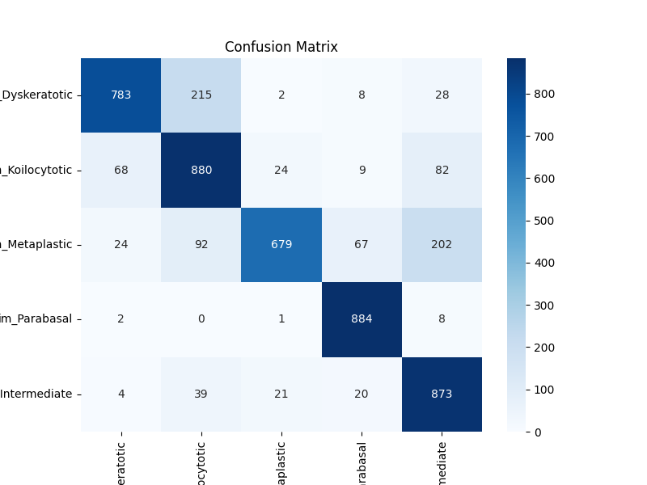
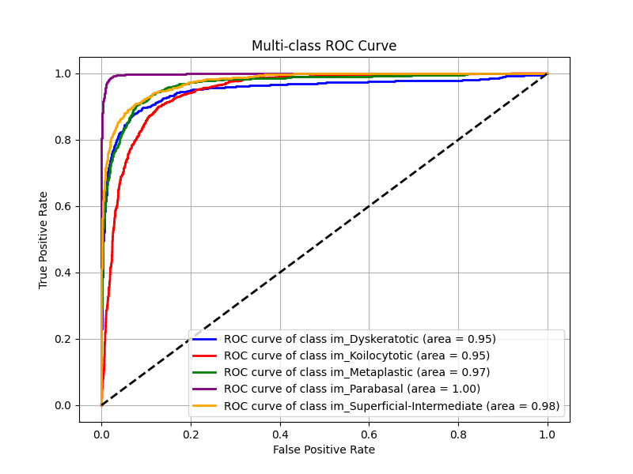
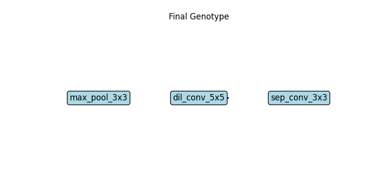

# Historical results and figure provenance

**Status:** Existing files from the supplied archive; not independently reproduced or validated. The visualizations below must not be interpreted as results from a reliable held-out test set.

| Artifact | Recorded value / interpretation | Validity |
|---|---|---|
| `outputs/results/metrics.txt` | ResNet accuracy 0.9741; F1 0.9751 | Historical only; protocol not independently validated |
| `outputs/results/darts_classification_report.txt` | DARTS approx. 0.81 accuracy, 0.81 macro F1, support 1,003 | Historical only; random split mismatch may cause overlap |
| Earlier README | ResNet accuracy 78.43% | Conflicts with saved `metrics.txt`; provenance unresolved |
| `outputs/results/darts_genotype.txt` | Chosen operation labels | Not evidence of retrained discrete architecture |

## Existing DARTS confusion matrix

## Existing DARTS ROC

## Existing ResNet confusion matrix

## Existing ResNet ROC

## Existing genotype visualization

**Caution:** `src/nas_plot_genotype.py` uses a hardcoded genotype rather than loading the model-derived genotype; this image should not be presented as a verified learned architecture.

## Missing evidence
There are no saved train/validation/test sample manifests, reproducible experiment identifiers, complete training logs, independent test metrics, measured device-specific inference timings, or controlled multi-run comparisons in the supplied archive. No additional plots were generated, to avoid implying new experimental evidence.
